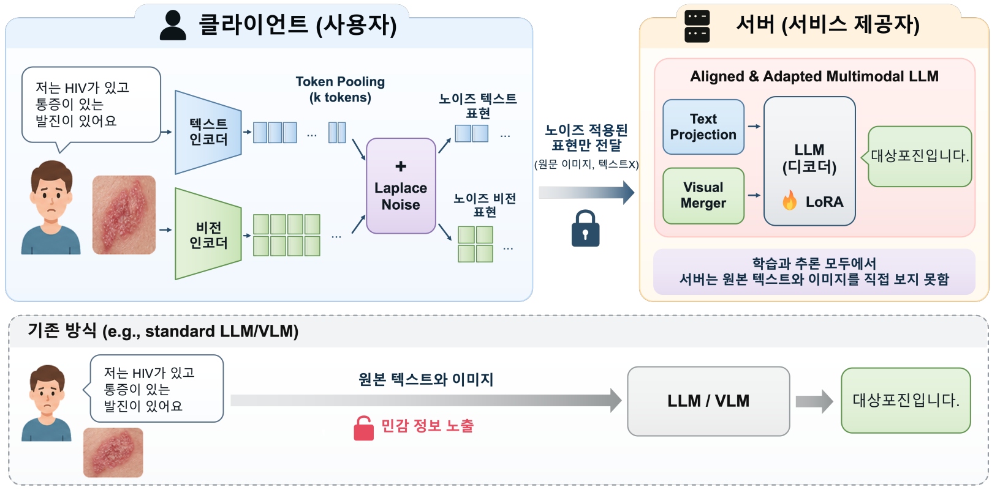

# PPFT-Multimodal · HCLT 2026

**원본 이미지/텍스트 전송 없이 민감정보를 처리하는 멀티모달 표현 정렬 및 도메인 학습 프레임워크**

PPFT-Multimodal은 클라이언트에서 텍스트를 KURE로, 이미지를 Qwen의 비전 인코더로 인코딩합니다. 서버의 Qwen3.5-0.8B는 전달받은 표현으로 의료 질문의 답을 생성합니다. 논문에서는 텍스트와 이미지 표현에 각각 노이즈를 더했을 때 의료 질의응답 정확도와 이미지 복원 오차가 어떻게 달라지는지 평가했습니다.



논문의 다섯 의료 QA 데이터셋 평균 정확도는 무노이즈에서 **43.44%**였습니다. 텍스트 ε를 75로 두고 이미지 ε를 2.0과 2.5로 설정해 각각 학습한 모델은 **36.92%**와 **36.82%**를 기록했습니다. [데이터셋별 결과와 실험 설정](docs/REPRODUCIBILITY.md)

## 설치

논문 실험은 Linux, Python 3.11, CUDA GPU 4개에서 bf16과 DeepSpeed ZeRO-2를 사용했습니다. 저장소를 복제한 뒤 가상환경을 만들고 Qwen과 KURE를 내려받습니다.

```bash
git clone https://github.com/Yoon-Jeong-ho/hclt2026_PPFT_Multimodal.git
cd hclt2026_PPFT_Multimodal

python3.11 -m venv .venv
source .venv/bin/activate
pip install -e '.[train]'

hf download Qwen/Qwen3.5-0.8B \
  --revision 2fc06364715b967f1860aea9cf38778875588b17 --local-dir models/qwen35-08b
hf download nlpai-lab/KURE-v1 \
  --revision 4ed4540949c70b7da2c74004a915e1f2d5e46e4f --local-dir models/kure-v1
```

## 데이터 준비

원본 데이터를 [JSONL 스키마](data/schema.md)에 맞춘 뒤 `scripts.prepare_data`를 실행합니다. 단계별 명령과 데이터셋 목록은 [데이터 준비 가이드](data/README.md)에 있습니다.

| 입력 파일 | 용도 |
|---|---|
| `data/processed/stage1/train.jsonl` | 텍스트·이미지 표현 정렬 |
| `data/processed/stage2/train.jsonl` | 의료 도메인 학습 |
| `data/processed/stage2/evaluation.jsonl` | 의료 QA 평가 |

## 학습

Stage 1에서는 비전 인코더 본체를 고정하고 KURE, 텍스트 프로젝터, 비전 머저와 언어모델을 학습합니다. Stage 2의 세 모델은 모두 같은 Stage 1 체크포인트에서 시작합니다. 각 모델은 지정된 노이즈 조건에서 텍스트 프로젝터, 비전 머저와 디코더 LoRA를 학습합니다.

```bash
accelerate launch --config_file configs/accelerate/paper.yaml -m scripts.train_stage1 \
  --config configs/stage1/paper.yaml \
  --qwen-path models/qwen35-08b --kure-path models/kure-v1

for arm in no_noise text_75_image_2 text_75_image_2p5; do
  accelerate launch --config_file configs/accelerate/paper.yaml -m scripts.train_stage2 \
    --config "configs/stage2/${arm}.yaml" \
    --qwen-path models/qwen35-08b --kure-path models/kure-v1
done
```

## 평가

**의료 질의응답.** 각 모델을 학습 때와 같은 노이즈 조건으로 평가합니다. 다음 명령은 모델별 답변을 생성하고 `outputs/utility/`에 데이터셋별 정확도를 저장합니다.

```bash
for arm in no_noise text_75_image_2 text_75_image_2p5; do
  python -m scripts.generate_predictions \
    --config "configs/stage2/${arm}.yaml" \
    --checkpoint "outputs/checkpoints/stage2/${arm}/final" \
    --evaluation data/processed/stage2/evaluation.jsonl \
    --qwen-path models/qwen35-08b --kure-path models/kure-v1 \
    --output "outputs/utility/${arm}.jsonl"
  python -m scripts.evaluate_utility "outputs/utility/${arm}.jsonl" \
    --output "outputs/utility/${arm}.json"
done
```

**이미지 복원.** PathVQA에서는 무노이즈 시각 표현으로 학습한 CNN을 사용해 노이즈 강도별 복원 오차(MSE)를 측정합니다. [PathVQA 평가 명령과 출력 파일](docs/REPRODUCIBILITY.md#pathvqa-이미지-복원)

## Acknowledgement

High-Performance Research AI Computing Infrastructure Support at the 2 PFLOPS Scale,\
Project Number: RS-2026-25505492.
